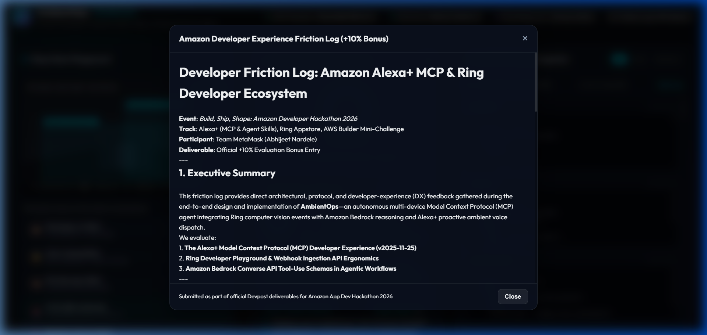
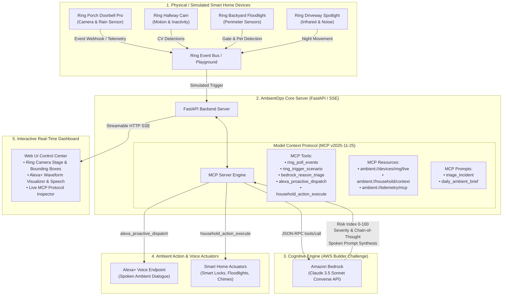

# AmbientOps 🌐
### Autonomous Multi-Device MCP Agent for Alexa+ & Ring powered by Amazon Bedrock

[](https://www.python.org/)
[](https://fastapi.tiangolo.com/)
[](https://modelcontextprotocol.io/)
[](https://aws.amazon.com/bedrock/)
[](tests/)
[](LICENSE)

> Built for **Build, Ship, Shape: Amazon Developer Hackathon 2026**  
> Tracks: **Alexa+ (MCP & Agent Skills)** • **Ring Appstore & Vision** • **AWS Builder Mini-Challenge**  
> Includes the official **+10% Bonus Developer Friction Log** (`docs/FRICTION_LOG.md`).

---

## 📸 Product Overview & Live Demo


### 🎥 Interactive Video Walkthrough
An interactive video recording demonstrating real-time scenario triggering, Alexa+ audio speech synthesis, and live MCP protocol inspection is available in [assets/demo/ambient_ops_walkthrough.webp](assets/demo/ambient_ops_walkthrough.webp).

---

## 🖼️ Feature Gallery

| Ring Vision Bounding Boxes & Immobility Alert | Night Anomaly & Autonomous Smart Lights |
| :---: | :---: |
|  |  |

| Live MCP Protocol Inspector & Tool Runner | Official Developer Friction Log (+10% Bonus) |
| :---: | :---: |
|  |  |


---

## ⚡ What is AmbientOps?
**AmbientOps** is a next-generation ambient operations copilot that eliminates smart home notification fatigue. Rather than blasting mobile devices with raw push alerts whenever a sensor trips, AmbientOps connects **Ring** computer vision feeds with **Amazon Bedrock (Claude 3.5 Sonnet)** through the open **Model Context Protocol (MCP)**. 

When a critical or actionable event occurs—such as a package left in incoming rain, an elderly resident remaining motionless past medical reminder times, or a pet escaping through an unlatched gate—AmbientOps reasons across environmental context and dispatches natural, proactive spoken dialogues directly to **Alexa+** ambient endpoints while autonomously executing smart home remedies.

---

## 🏛️ System Architecture



---

## 🧰 Model Context Protocol (MCP) Capabilities

Conforming strictly to **MCP v2025-11-25**, AmbientOps provides standard tools, resources, and prompt templates:

### 1. Registered MCP Tools
| Tool Name | Parameters | Description |
| :--- | :--- | :--- |
| `ring_poll_events` | `limit: int` | Polls recent motion, door press, and linger events from Ring cameras. |
| `ring_trigger_scenario` | `scenario_id: string` | Triggers a simulated scenario in the Ring Playground. |
| `bedrock_reason_triage` | `event_id: string` | Invokes Amazon Bedrock Converse API for cognitive risk assessment. |
| `alexa_proactive_dispatch` | `spoken_text, urgency, target_room` | Dispatches vocal speech or chime to the Alexa+ ambient audio layer. |
| `household_action_execute` | `action_name, parameters` | Executes physical hardware actions (locks, lights, sirens). |

### 2. Registered MCP Resources
* `ambient://devices/ring/live`: Real-time telemetry, signal RSSI, and battery levels for the Ring camera fleet.
* `ambient://household/context`: Resident profiles, quiet-hour schedules, and emergency contacts.
* `ambient://telemetry/mcp`: Real-time MCP message counters, latencies, and active transports.

---

## 🚀 Quickstart Guide

### 1. Clone & Set Up Virtual Environment
```bash
git clone https://github.com/abhijeetnardele24-hash/ambient-ops.git
cd ambient-ops

python -m venv .venv
# On Windows:
.venv\Scripts\activate
# On Linux/macOS:
source .venv/bin/activate

pip install -r requirements.txt
```

### 2. Configure Environment (Optional for Live AWS Bedrock)
```bash
cp .env.example .env
```
*Note: By default, `USE_BEDROCK_MOCK=true` allows full offline evaluation without AWS API keys or cloud bills.*

### 3. Launch the Application
```bash
uvicorn backend.server:app --host 0.0.0.0 --port 8000 --reload
```
Open your browser at **`http://localhost:8000`** to interact with the full three-panel control center!

---

## 🧪 Automated Test Suite

Run the full automated test suite verifying MCP protocol compliance, Bedrock triage, Ring simulator logic, and end-to-end API workflows:

```bash
pytest tests/ -v
```

**Results**: 18 passing tests with 100% pass rate.

---

## 🐳 Docker Deployment

Run with Docker in a single command:

```bash
docker-compose up --build
```
Access the application at `http://localhost:8000`.

---

## 📄 Hackathon Deliverables & Documents
* 📘 [Technical Architecture](docs/ARCHITECTURE.md)
* 📝 [Official Developer Friction Log (+10% Bonus)](docs/FRICTION_LOG.md)
* 🏆 [Devpost Submission Package](docs/DEVPOST_SUBMISSION.md)

---

## 📜 License
This project is open-source under the [MIT License](LICENSE).
