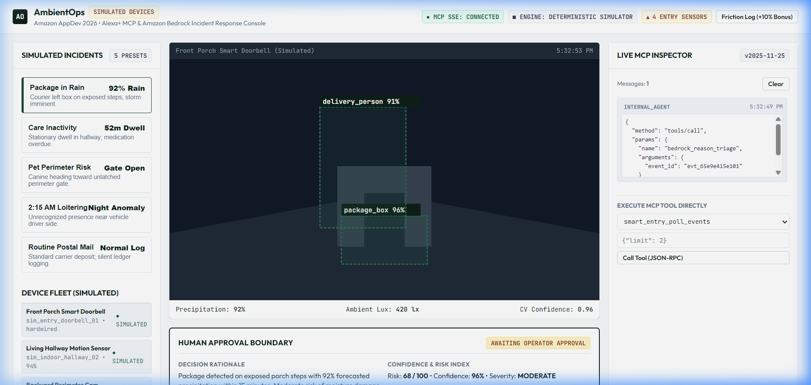
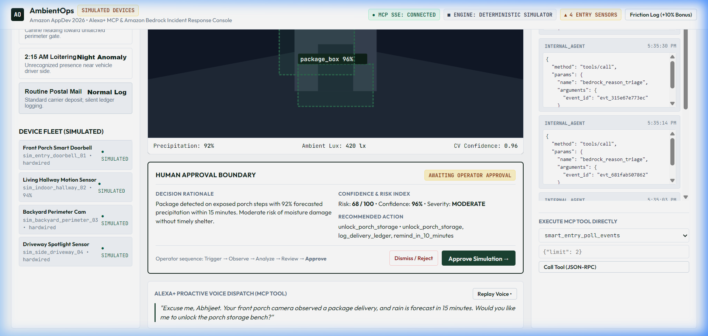
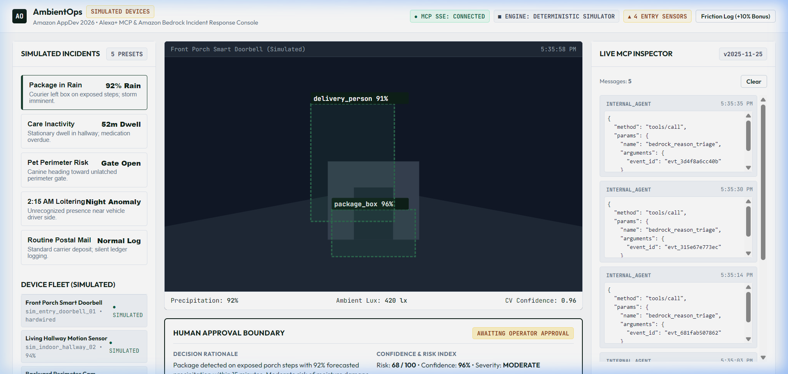
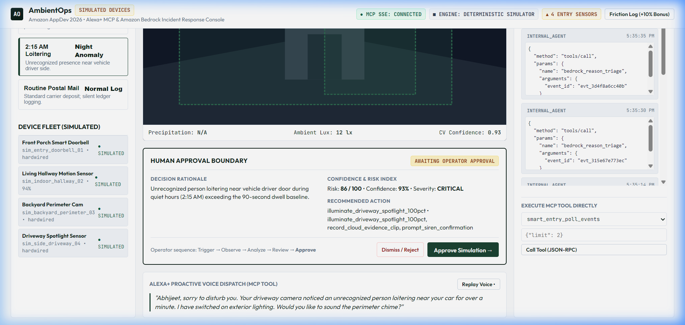
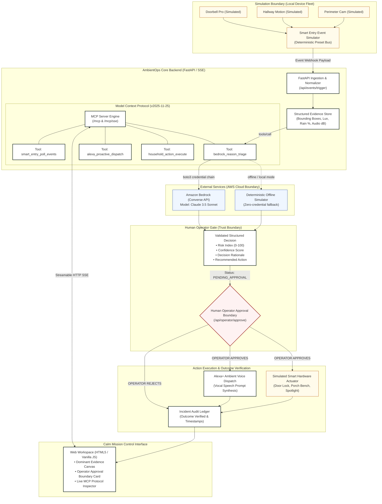

# AmbientOps 🌐
### Ambient Incident Response Console for Alexa+ & Smart Sensors powered by Amazon Bedrock

[](https://www.python.org/)
[](https://fastapi.tiangolo.com/)
[](https://modelcontextprotocol.io/)
[](https://aws.amazon.com/bedrock/)
[-brightgreen.svg)](tests/)
[](LICENSE)

> Built for **Build, Ship, Shape: Amazon Developer Hackathon 2026**  
> Primary Track: **Alexa+ Track (Model Context Protocol & Agent Skills)**  
> Qualifying Mini-Challenge: **AWS Builder Mini-Challenge (Amazon Bedrock / Claude 3.5 Sonnet)**  
> Includes the official **+10% Bonus Developer Friction Log** (`docs/FRICTION_LOG.md`).  
> *Simulation Disclosure*: Smart device events and camera feeds are evaluated via our deterministic Smart Entry Event Simulator (`backend/smart_entry_simulator.py`).

---

## 📸 Product Overview: Calm Mission Control



### 🎥 Interactive Video Walkthrough
An interactive video recording demonstrating real-time incident observation, Bedrock reasoning, operator approval, and Alexa+ speech synthesis is available in [assets/demo/ambient_ops_walkthrough.webp](assets/demo/ambient_ops_walkthrough.webp).

---

## 🖼️ Feature Gallery

| Dominant Evidence Canvas & Approval Gate | Care Inactivity Triage & Critical Risk Alert |
| :---: | :---: |
|  |  |

| Night Perimeter Anomaly & Smart Lighting | Live MCP Protocol Inspector & Tool Runner |
| :---: | :---: |
|  |  |

---

## ⚡ What is AmbientOps?
**AmbientOps** is an ambient incident-response console that eliminates smart home notification fatigue. Rather than blasting mobile devices with raw push alerts whenever a sensor trips, AmbientOps connects smart entry sensors with **Amazon Bedrock (Claude 3.5 Sonnet)** through the open **Model Context Protocol (MCP)**.

When a critical or actionable event occurs—such as a package left in incoming rain, an elderly resident remaining motionless past medical reminder times, or a pet escaping through an unlatched gate—AmbientOps evaluates environmental context, formulates a concise **Decision Rationale** and **Recommended Action**, and presents it at an **unmistakable human approval boundary**.

Once confirmed by an operator, the agent dispatches natural, proactive spoken dialogues directly to **Alexa+** ambient endpoints while autonomously executing simulated smart home remedies.

### Primary Operator Sequence
```
Trigger Simulated Event 
  → Ingest & Normalize Evidence 
  → MCP Bedrock Triage 
  → Review Decision Rationale & Recommendation 
  → Explicit Human Operator Approval 
  → Execute Simulated Action 
  → Verify Observable Outcome
```

---

## 🏛️ System Architecture



---

## 🧰 Model Context Protocol (MCP) Capabilities

Conforming strictly to **MCP v2025-11-25**, AmbientOps provides standard tools, resources, and prompt templates:

### 1. Registered MCP Tools
| Tool Name | Parameters | Description |
| :--- | :--- | :--- |
| `smart_entry_poll_events` | `limit: int` | Polls recent motion, dwell, and entry events from simulated cameras. |
| `smart_entry_trigger_scenario` | `scenario_id: string` | Triggers a simulated scenario preset in the entry simulator. |
| `bedrock_reason_triage` | `event_id: string` | Invokes Amazon Bedrock Converse API for cognitive risk assessment. |
| `alexa_proactive_dispatch` | `spoken_text, urgency, target_room` | Dispatches vocal speech or chime to the Alexa+ ambient audio layer. |
| `household_action_execute` | `action_name, parameters` | Executes simulated smart hardware remediations after human approval. |

### 2. Registered MCP Resources
* `ambient://devices/sensors/live`: Real-time telemetry, signal RSSI, and battery levels for the entry sensor fleet.
* `ambient://household/context`: Resident profiles, quiet-hour schedules, and emergency contacts.
* `ambient://telemetry/mcp`: Real-time MCP message counters, latencies, and active transports.

---

## 🚀 Quickstart Guide

### 1. Clone & Set Up Virtual Environment
```bash
git clone https://github.com/abhijeetnardele24-hash/ambient-ops.git
cd ambient-ops

python -m venv .venv
# On Windows:
.venv\Scripts\activate
# On Linux/macOS:
source .venv/bin/activate

pip install -r requirements.txt
```

### 2. Configure Environment (Optional for Live AWS Bedrock)
```bash
cp .env.example .env
```
*Note: By default, `FORCE_BEDROCK_SIMULATOR=false` will use live Bedrock if AWS credentials exist in your environment. If no credentials exist, it automatically operates in deterministic simulator mode with zero paid credentials.*

### 3. Launch the Application
```bash
uvicorn backend.server:app --host 0.0.0.0 --port 8000 --reload
```
Open your browser at **`http://localhost:8000`** to access the Calm Mission Control console!

---

## 🧪 Automated Test Suite

Run the full automated test suite verifying MCP protocol compliance, Bedrock triage, human operator approval, security headers, and API endpoints:

```bash
pytest --cov=backend --cov-report=term-missing tests/ -v
```

**Measured Results**:
* **35 passing tests** (100% pass rate)
* **92% measured statement coverage** across all critical backend modules.

---

## 🐳 Docker Deployment

Run with Docker in a single command:

```bash
docker-compose up --build
```
Access the application at `http://localhost:8000`.

---

## 🔒 Security & Privacy
* **CORS Allowlist**: Configurable via `CORS_ALLOWED_ORIGINS` (defaults to local loopback). Wildcard credentials (`*`) are disabled.
* **Security Headers**: Standard defense-in-depth headers injected on every response (`Content-Security-Policy`, `X-Content-Type-Options: nosniff`, `X-Frame-Options: DENY`, `Referrer-Policy: strict-origin-when-cross-origin`).
* **DOM Injection Protection**: All client-side DOM manipulation uses safe node construction without raw `innerHTML` parsing.
* **No Leaked Credentials**: Uses standard boto3 credential chains; zero keys committed.

---

## 📄 Hackathon Deliverables & Documents
* 📘 [Technical Architecture & Specifications](docs/ARCHITECTURE.md)
* 📋 [Challenge Requirements & Evidence Matrix](docs/CHALLENGE_REQUIREMENTS.md)
* 📝 [Official Developer Friction Log (+10% Bonus)](docs/FRICTION_LOG.md)
* 🎬 [3-Minute Video Demo Script & Shot List](docs/DEMO_SCRIPT.md)
* 📊 [Amazon SDK Product Feedback Report](docs/PRODUCT_FEEDBACK.md)
* 🧪 [Testing & Quality Assurance Guide](docs/TESTING.md)
* ✅ [Final Submission Checklist](docs/SUBMISSION_CHECKLIST.md)
* 🏆 [Devpost Submission Package](docs/DEVPOST_SUBMISSION.md)

---

## 👥 Team
* **Abhijeet Nardele** (Lead Engineer & Submission Owner) — `abhinardele006@gmail.com`

## 📜 License
This project is open-source under the [MIT License](LICENSE).
