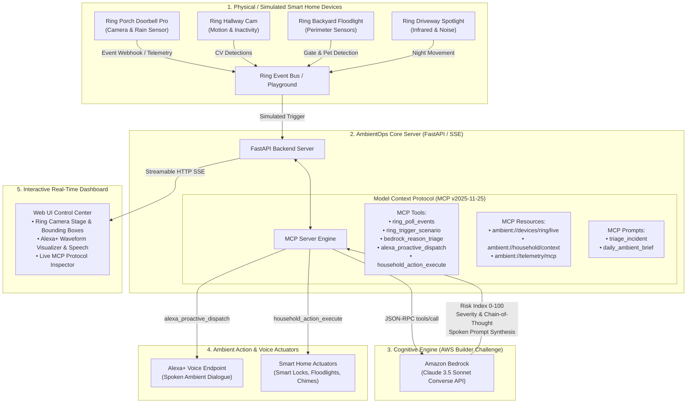

# AmbientOps Architecture & Technical Specification

## System Overview
**AmbientOps** is an autonomous multi-device Model Context Protocol (MCP) agent designed for **Alexa+** and **Ring**, powered by **Amazon Bedrock** (Claude 3.5 Sonnet / AgentCore).

It continuously observes environmental sensor events and computer vision detections from Ring cameras, performs cognitive risk triage through Amazon Bedrock, and autonomously dispatches proactive vocal notifications to Alexa+ endpoints while executing connected home remediations.

---

## Architectural Diagram



---

## MCP Tool Schemas

### 1. `ring_poll_events`
* **Description**: Queries recent motion, doorbell press, and linger events from connected Ring devices.
* **Input Schema**:
  ```json
  {
    "type": "object",
    "properties": {
      "limit": { "type": "integer", "description": "Max events to retrieve (default: 5)" }
    }
  }
  ```

### 2. `bedrock_reason_triage`
* **Description**: Evaluates an event using Amazon Bedrock to calculate risk scores and formulate conversational speech.
* **Input Schema**:
  ```json
  {
    "type": "object",
    "properties": {
      "event_id": { "type": "string", "description": "Ring event unique identifier" }
    },
    "required": ["event_id"]
  }
  ```

### 3. `alexa_proactive_dispatch`
* **Description**: Dispatches synthesized voice audio or notification chime to a target Alexa+ endpoint.
* **Input Schema**:
  ```json
  {
    "type": "object",
    "properties": {
      "spoken_text": { "type": "string" },
      "urgency": { "type": "string", "enum": ["low", "moderate", "critical"] },
      "target_room": { "type": "string" }
    },
    "required": ["spoken_text", "urgency"]
  }
  ```

### 4. `household_action_execute`
* **Description**: Executes connected smart home hardware automations.
* **Input Schema**:
  ```json
  {
    "type": "object",
    "properties": {
      "action_name": { "type": "string" },
      "parameters": { "type": "object" }
    },
    "required": ["action_name"]
  }
  ```
