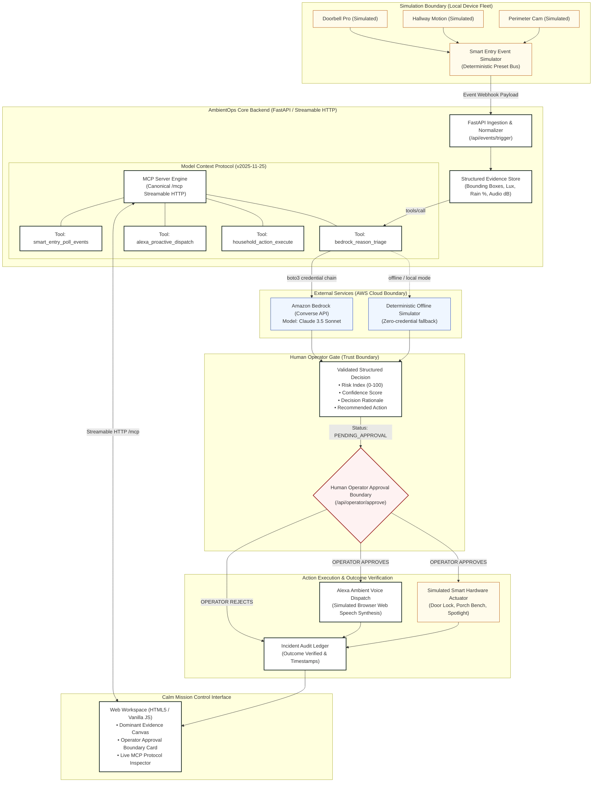

# AmbientOps Technical Architecture & Specification

## 1. System Overview
**AmbientOps** is an ambient incident-response console designed for **Alexa+** and connected smart entry sensors, powered by **Amazon Bedrock** (Claude 3.5 Sonnet / AgentCore).

The primary operator sequence strictly enforces a **human approval boundary**:
```
Trigger Simulated Event 
  → Ingest & Normalize Evidence 
  → MCP Bedrock Triage 
  → Review Decision Rationale & Recommendation 
  → Explicit Human Operator Approval 
  → Execute Simulated Action 
  → Verify Observable Outcome
```

---

## 2. End-to-End Architectural Diagram



---

## 3. Trust Boundaries & Security Architecture
1. **Simulation vs Production Boundary**: All smart entry cameras and motion detectors run in local simulated mode (`is_simulated = True`). No unverified third-party hardware commands are transmitted to external IoT networks.
2. **AWS Cloud Boundary**: Communication with Amazon Bedrock occurs over HTTPS via `boto3.client('bedrock-runtime').converse()`. If AWS credentials are not configured in the host environment, the system strictly isolates execution within the deterministic local simulator, guaranteeing zero unexpected cloud bills.
3. **Human Approval Boundary**: The application explicitly requires an operator confirmation step (`/api/operator/approve/{incident_id}`) before executing simulated remediations (such as unlocking smart locks or triggering floodlights). Automated escalation cannot bypass this boundary.
4. **Model Context Protocol Boundary**: All external tool execution from an Alexa+ client passes through strict Pydantic input schemas and JSON-RPC 2.0 error validation (-32600, -32601, -32602, -32603).
